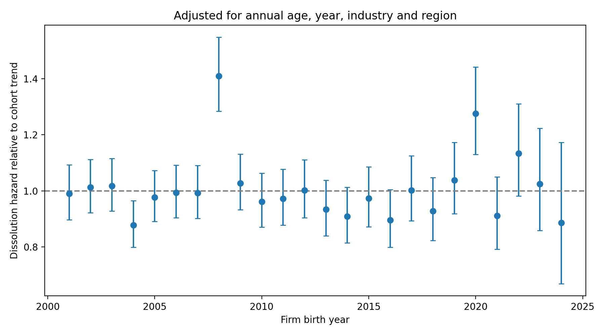

# Annual age–period–cohort analysis of firm dissolution

Estimate differences in dissolution risk between birth-year cohorts, allowing for firm age, calendar year, industry and region. The model uses **annual effects and exact days of exposure**.

The included example contains **synthetic data only**. Its estimates do not describe actual UK firms.

## Files

Keep these five files in the same folder:

| File | Purpose |
| --- | --- |
| [apc_dissolution.py](apc_dissolution.py) | Sequential Python script for estimation and plotting |
| [example_firms.csv](example_firms.csv) | Example data containing 12,000 invented firms |
| [README.md](README.md) | Model explanation and running instructions |
| [cohort_effects.csv](cohort_effects.csv) | Annual cohort estimates and confidence intervals |
| [cohort_effects.png](cohort_effects.png) | Figure produced by the script |

## Quick start

Open a terminal in this folder and install the dependencies:

```bash
python -m pip install numpy pandas scipy patsy statsmodels matplotlib
```

Run the script:

```bash
python apc_dissolution.py
```

Use `python3` or `py` instead of `python` if that is the command used by your installation. In an IDE, set the working folder and run the whole file. No command-line flags are needed.

To analyse your own data, edit the settings near the top of the script:

```python
FILE = 'example_firms.csv'
START, END = 2001, 2024
```

`START` is the first included birth year and observation year. `END` is the last included birth year and observation year. The code follows firms until dissolution or **31 December of `END`**, whichever comes first. Births before `START` are excluded. Set `END` to the last year with complete dissolution coverage.

A relative filename is resolved from the working folder. Keep the input CSV there or set `FILE` to its full path.

The script prints the estimates and writes `cohort_effects.csv` and `cohort_effects.png` to the working folder. **Each run overwrites these two outputs.** Copy them elsewhere before comparing specifications.

## Input data

Supply one row per firm, including dissolved firms and survivors. Use these exact column names:

| Column | Content |
| --- | --- |
| `firm_id` | Unique, nonmissing firm identifier |
| `birth_date` | Birth date in `YYYY-MM-DD` format |
| `dissolution_date` | Dissolution date in `YYYY-MM-DD` format; blank if known to be alive at the study cutoff |
| `industry` | Consistent industry category, preferably measured at birth |
| `region` | Consistent regional category, preferably measured at birth |

For example:

```csv
firm_id,birth_date,dissolution_date,industry,region
001,2005-03-12,2012-08-20,62,London
002,2008-07-01,,47,South East
003,2010-11-25,2020-04-03,56,Scotland
```

These three rows demonstrate the format; use the full [example CSV](example_firms.csv) to fit the example model.

Two-digit SIC is a practical starting point for industry. Use classifications that are comparable over time. Final observed industry or region may reflect changes after birth, so birth classifications are preferable when available.

A dataset containing only current survivors cannot recover historical dissolution hazards. A blank dissolution date must mean the firm is known to remain alive at the cutoff, rather than that its exit date is unknown. The script assumes complete follow-up to dissolution or a common cutoff; it does not accept firm-specific censoring dates.

Legal incorporation and dissolution dates measure registered-company survival. They need not coincide with the start and end of trading. If your source resets age on reactivation, reconcile activity spells with the intended birth definition first.

## The model

A hazard is the dissolution rate among firms still alive. The model lets it change each calendar year and assumes it is constant within the observed portion of a firm-year:

$$
\log h_{it} = \alpha_{a_{it}} + \pi_t + \gamma_{c_i} + \delta_{s_i} + \rho_{r_i}.
$$

| Component | Interpretation |
| --- | --- |
| Age effect $\alpha_a$ | Common life-cycle pattern in dissolution risk |
| Period effect $\pi_t$ | Conditions affecting firms in calendar year $t$ |
| Cohort effect $\gamma_c$ | Persistent differences between firms born in year $c$ |
| Industry effect $\delta_s$ | Baseline differences between industries |
| Region effect $\rho_r$ | Baseline differences between regions |

Annual age is defined as **calendar year minus birth year**. It is an annual age index, rather than completed age on every day. Industry and region enter as additive fixed effects, with their relative hazards assumed constant over time.

### Exact exposure within each year

For each firm-year, observation starts at the later of birth and 1 January. It ends at dissolution, the year's end or the study cutoff, whichever comes first.

The code places birth at the start of its recorded day and dissolution at the end of its recorded day. A same-day birth and dissolution therefore contributes one day of exposure. Exposure is observed days divided by 365.25, expressed in firm-years.

For example, a firm born on 1 July 2020 and dissolved on 15 March 2022 contributes partial exposure in 2020, full exposure in 2021, and partial exposure plus one event in 2022. Its annual age indices are 0, 1 and 2.

Firms alive at the cutoff contribute exposure and no dissolution event. This is right censoring. Exact dates improve exposure measurement even though the model's effects are annual.

### Identification

The time indices satisfy:

$$
t = a + c.
$$

Consequently, unrestricted linear age, period and cohort trends cannot be separated. Exact dates do not remove this identification problem.

The code identifies cohort **deviations from a linear trend** by imposing:

$$
\sum_c \gamma_c = 0,
\qquad
\sum_c (c-\bar c)\gamma_c = 0.
$$

Each included cohort receives equal weight in these constraints. Age and period effects absorb the remaining trends. The plot can identify unusually strong or weak cohorts, but cannot establish a long-run improvement or deterioration across successive generations. Changing the included cohort range changes the reference trend.

## How the code works

The script runs sequentially in five stages.

1. **Read and validate.** Load the CSV, parse dates, check identifiers and missing controls, reject dissolution before birth, and select birth cohorts from `START` through `END`.
2. **Construct annual cells.** Count events and exact exposure, then aggregate firms sharing age, period, cohort, industry and region. Retain cells with exposure and zero events.
3. **Build the design.** `patsy.dmatrix` creates categorical age, period, industry and region effects. `scipy.linalg.null_space` constructs a cohort basis `B` orthogonal to a constant and a linear cohort trend. Writing `gamma = B @ theta` imposes the identification constraints directly.
4. **Estimate.** `statsmodels.GLM` fits a Poisson model with log exposure as an offset. The script checks design rank and numerical convergence, then transforms the cohort coefficients and covariance back from the constrained basis.
5. **Export.** Save and print cohort hazard ratios and pointwise model-based 95% confidence intervals, and draw the plot with a reference line at 1.

### Why Poisson regression estimates a survival model

Within a cell, all firms share a hazard. Let $D_j$ be the dissolution count and $E_j$ the total exposure. The Poisson formulation uses mean $\mu_j=E_jh_j$:

$$
\log \mu_j = \log E_j + \alpha_a + \pi_t + \gamma_c + \delta_s + \rho_r.
$$

The exposure offset has coefficient fixed at one. The piecewise-exponential survival log likelihood contains $D_j\log h_j-E_jh_j$. The Poisson formulation yields the same parameter-dependent terms. This is why event counts and actual exposure estimate the survival model.

Aggregation preserves these terms. An unweighted regression of cell exit percentages would be a different procedure.

The reported cohort ratio is $\exp(\gamma_c)$. Its interval is:

$$
\left[\exp(\gamma_c-1.96\,SE_c),\;\exp(\gamma_c+1.96\,SE_c)\right].
$$

## Example output

The example run includes all 12,000 synthetic firms, with 8,242 dissolutions and 3,758 firms alive at the cutoff. It produces 24 birth-year estimates for 2001–2024. The annual run completed without numerical warnings.



Bars show pointwise model-based 95% confidence intervals. All values come from invented data.

| Birth cohort | Relative hazard | 95% confidence interval |
| --- | ---: | ---: |
| 2008 | 1.409 | 1.284–1.547 |
| 2020 | 1.276 | 1.129–1.442 |

The complete table is in [cohort_effects.csv](cohort_effects.csv).

### Interpretation

- **1.0:** no deviation from the cohort trend, conditional on annual age, calendar year, industry and region.
- **1.2:** a hazard 20% above the cohort trend.
- **0.8:** a hazard 20% below the cohort trend.

For example, the synthetic 2008 cohort's estimated hazard is about 41% above its cohort trend. These are descriptive adjusted differences, not causal effects of birth year.

A hazard ratio is not a percentage-point change in dissolution probability. With a constant reference hazard of 0.10 per year, the one-year probability is $1-\exp(-0.10)$, about 9.5%. A hazard ratio of 1.2 raises it to $1-\exp(-0.12)$, about 11.3%.

An interval crossing 1 means that the cohort deviation is not distinguishable from zero at the conventional pointwise 5% level. The intervals are not simultaneous confidence bands across cohorts. Recent cohorts have shorter follow-up; the additive model assumes their cohort effect persists across ages, including ages they have not yet reached.

## Limits and research checks

The intervals are model-based and assume independent firms and the specified hazard model. The script does not implement clustered standard errors, a firm bootstrap or extra allowance for common shocks. A firm bootstrap would resample whole firms and repeat the complete estimation; company-group dependence would require an appropriate group-level approach.

Check birth and dissolution definitions, complete follow-up, and comparable industry and region classifications. Inspect categories with few observations or no exits. Compare adjusted results with raw survival-to-age-five rates for cohorts with enough follow-up, and check sensitivity to the cohort range and observation cutoff.

Industry-by-year and region-by-year effects are possible extensions when sectors or places face different shocks. They are not included here and would require reference categories and rank checks.

The script reads all firm records into memory and uses a dense design after aggregation. Start with a pilot and coarse industry categories. A full-population analysis may need aggregation in chunks or a sparse estimator; neither is implemented in this short script.

## Troubleshooting

| Problem | What to check |
| --- | --- |
| `ModuleNotFoundError` | Install the dependencies with the same Python executable used to run the script. |
| File not found | Set the working folder or give `FILE` its full path. |
| Missing columns or invalid dates | Use the exact headers and `YYYY-MM-DD` dates. Correct malformed dates rather than treating affected firms as survivors. |
| Redundant controls or insufficient support | Check perfectly overlapping categories and cohort support. Simplify redundant controls. |
| Failure to converge or extreme estimates | Inspect categories with no exits or little exposure. Combine categories only when substantively defensible. |
| Excessive memory use | Begin with a pilot and consider chunked aggregation or a sparse implementation. |

## References

- Nielsen, B. (2015). [apc: An R Package for Age-Period-Cohort Analysis](https://journal.r-project.org/articles/RJ-2015-020/). *The R Journal*, 7(2), 52–64. Explains identifiable APC parameterisations and deviations from linear trends.
- [Statsmodels GLM documentation](https://www.statsmodels.org/stable/generated/statsmodels.genmod.generalized_linear_model.GLM.html), including offsets and exposure.
